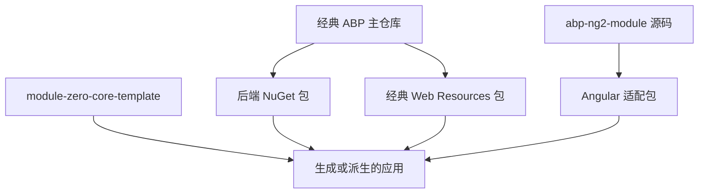

# 经典 ABP Angular 生态维护指南

## abp-ng2-module、abp-web-resources 与 module-zero-core-template

## 当前状态（2026-11-28）

- 适配器与免费启动模板已接入主仓。主仓 `8dcdca6f5aaa892225bcef74846eefce24f4f0d0` 固定的适配器源码声明 `13.0.0`、Angular peer `^21.0.0`。固定模板声明 Angular `^19.2.1`、适配器 `12.1.0` 和资源包 `^6.1.0`。已为模板选定适配器 `12.1.0` 的独立参考提交，其 peer 为 `^19.1.7`。[组件参考与模板依赖](../maintenance/release-baseline.json) · [gitlink 核对方法](../README.md#子模块分工)
- 固定免费模板已在 macOS ARM64 从空缓存安装公开 `abp-ng2-module 12.1.0` 和 `abp-web-resources 6.1.0`，并以 Angular `19.2.1` 重建冻结 production 前端。公开 R4 和 R5 的浏览器角色编辑另有同一冻结前端下的实测记录。[公开冷构建](../maintenance/r5-public-angular-rebuild.md#实测结果) · [角色编辑实测](../maintenance/r5-angular-user-role-edit.md)
- macOS ARM64 实测中，适配器 `12.1.0` 发布参考提交 `afbd23e` 的根锁冻结安装失败。相同库源码在后续提交 `a8ca4b3` 成功制包，固定 Angular `19.2.1` 模板只替换适配器后通过 production 编译，并从新浏览器 JS 追溯到候选 FESM。资源包沿用公开 `6.1.0`。[适配器制包与消费实测](../maintenance/r5-angular19-adapter-package-plan.md#实测结果) · [稳定规范](../../openspec/specs/template-maintenance-package-consumption/spec.md#requirement-固定-angular-19-模板可验收源码制成的适配器包)
- 独立资源包试验从框架 Git 原字节制成 `abp-web-resources 6.1.0`，同一模板沿用公开适配器 `12.1.0`。macOS ARM64 冻结安装、Angular `19.2.1` production 新构建、两个声明和静态资源的消费已通过。Chrome 实收全局脚本并运行 `formatString`，两个 SignalR 资产 URL 返回 HTTP 200 且原字节逐项匹配候选。验收要求已同步，六项任务已归档。[Web Resources 实测与复跑](../maintenance/r5-angular19-web-resources-plan.md#实测结果) · [稳定规范](../../openspec/specs/template-maintenance-package-consumption/spec.md#requirement-固定-angular-19-模板可验收从经典框架-git-制成的资源包) · [归档任务](../../openspec/changes/archive/2026-11-28-validate-r5-angular19-web-resources/tasks.md)
- 两份本地候选在固定 Angular `19.2.1` 模板同时通过 macOS ARM64 冻结实装和 production 构建。同阶段与仅换资源的 1193 个浏览器产物逐字节一致。本轮最小页复跑获得三个 HTTP 200、匹配正文及精确 `formatString` 返回。验收要求已同步到稳定规范，六项任务已归档。[双包实测与复跑](../maintenance/r5-angular19-package-pair.md) · [稳定规范](../../openspec/specs/template-maintenance-package-consumption/spec.md#requirement-固定-angular-19-模板可同时验收两份本地-npm-候选) · [归档任务](../../openspec/changes/archive/2026-11-28-validate-r5-angular19-package-pair/tasks.md)
- BOOT-01 匿名首次访问及相关初始化已通过本机双侧对照。双包和全公开冻结前端分别在同一 R5 Host 上从根路径到达匿名登录表单。[实测和复跑](../maintenance/r5-angular19-anonymous-bootstrap.md) · [稳定规范](../../openspec/specs/template-maintenance-package-consumption/spec.md#requirement-固定-angular-19-模板可对照双包候选的匿名首次启动) · [归档任务](../../openspec/changes/archive/2026-11-28-validate-r5-angular19-anonymous-bootstrap/tasks.md)

### Web Resources 分发维护登记

- **权威资源。** 资源实现随经典框架子模块维护。本轮固定框架提交 `7933e71f5646d2447af3502ecbea9a3f1aba8184` 下的 `src/Abp.Web.Resources/Abp/Framework`，本地实包的 40 个资源从该提交的 Git blob 取得。[框架资源树](https://github.com/dusdong/aspnetboilerplate/tree/7933e71f5646d2447af3502ecbea9a3f1aba8184/src/Abp.Web.Resources/Abp/Framework)
- **分发参考。** 登记 `dusdong/bower-abp-resources`。2026-11-28 回读时 fork 与上游 `master` 均指向 `8084a3756221b966693d17458faca7f8e8ebdcd0`，GitHub Compare 显示领先和落后均为 0。固定分发快照的 `Abp/Framework` 与框架资源树逐路径相对照，40/40 个路径及 blob 一致。旧 Gulp 用 NuGet `Abp.Web.Resources 5.1.0` 提取资源，属于历史流程。[分发 fork](https://github.com/dusdong/bower-abp-resources) · [fork 固定快照](https://github.com/dusdong/bower-abp-resources/tree/8084a3756221b966693d17458faca7f8e8ebdcd0) · [上游固定快照](https://github.com/aspnetboilerplate/bower-abp-resources/tree/8084a3756221b966693d17458faca7f8e8ebdcd0) · [旧提取配置][R11]
- **候选包装。** 当前 `abp-web-resources 6.1.0` 候选的 `package.json` 与 `LICENSE` 取自上游固定提交 `fb79b7d44bc9dfce0ae600c8170961f182b05e76`，fork 可按同一提交读取两份相同 blob。复跑继续固定该提交和两份 blob，按已验步骤将包装清单的版本改为 `6.1.0`。[上游包装提交](https://github.com/aspnetboilerplate/bower-abp-resources/tree/fb79b7d44bc9dfce0ae600c8170961f182b05e76) · [fork 包装提交](https://github.com/dusdong/bower-abp-resources/tree/fb79b7d44bc9dfce0ae600c8170961f182b05e76) · [包装原件和摘要](../maintenance/r5-angular19-web-resources-plan.md#候选归档与包契约)

当分发 fork 实际承担独立制包、校验或分发职责，且主仓需要同时固定框架资源与分发工具的提交时，再把它接入为第七个子模块。本地 tarball 的制包和验收也可能需要同时固定这两个提交，公开 npm 发行另行决定。

**下文保留原调研证据和当时的组合判断。**

> 更新日期：2026-11-23（Asia/Shanghai）。  
> 适用目标：长期维护、独立发行经典 ASP.NET Boilerplate，并兼容现有 Angular 消费项目。  
> 文档形式：一份综合指南，三个项目各有独立章节，共用版本、兼容与发行规则。  
> 证据范围：公开 GitHub 源码、官方文档、公开包元数据。尚未执行依赖安装、构建、浏览器测试、生产验证或实际发布。

## 一、结论与维护范围

建议把这三个项目作为同一条维护链管理：

- **abp-ng2-module：** Angular 与经典 ABP 的适配层，需要独立关注其源码和发行。
- **abp-web-resources：** 浏览器端基础资源；源码在经典 ABP 主仓库，另有资源分发仓库，应保持单一修改来源。
- **module-zero-core-template：** 免费启动模板，优先用作整个维护发行版的集成验收项目，再考虑向用户发行模板。

它们分别解决“Angular 怎样调用 ABP”“浏览器中的 ABP API 从哪里来”“用户如何得到一个能够运行的项目”。把三者放在一份文档中，可以统一追踪版本组合和验收结果，减少重复而相互矛盾的维护规则。[R01][R09][R15]

**当前最需要解决的两件工程问题：**

1. 当前模板的 Angular 声明与当前适配器主分支的 peer 范围不同，不能把三个仓库的最新分支直接拼成一个已验证组合。
2. 资源分发仓库的 npm 版本与旧 NuGet 提取配置不同，且旧脚本依赖 Windows 风格命令；需要重新建立明确、可验证的发行流程。

这两项是静态源码事实及其工程影响，不能据此认定现有公开发行包必然损坏。

### 1.1 已确定的用户约束

| 约束 | 本指南的处理 |
| --- | --- |
| 经典 ABP 的 `Abp` / `Abp.*` 命名空间长期保持不变 | 作为后端兼容性硬约束 |
| `Du.` 前缀只用于 NuGet PackageId | 不自动扩展为 C#、TypeScript、JavaScript 或 npm 命名规则 |
| 存量项目必须保留正常业务行为 | 兼容性修复优先；升级 Angular、换 UI 库或改变协议另行评审 |
| 程序原生运行于 Windows、Linux、macOS | 拟议构建与验收使用原生环境，不引入 Docker、Kubernetes 或虚拟机前提 |
| AutoMapper 存量行为要求继续有效 | 本指南补充前端维护范围，不替代后端映射方案 |
| Parquet 首包独立推进 | 不把本生态接管设为无关包发行的前置条件 |

以下属于由兼容目标推导出的**建议约束**：保留已有 TypeScript 导出、全局 `abp` API、HTTP 约定、类型声明与消费者使用的资源路径。它们应在确认真实消费项目后写入正式兼容合同。

### 1.2 角色、来源与交付物

| 对象 | 源码或仓库 | 交付与用途 | 维护判断 |
| --- | --- | --- | --- |
| Angular 适配层 | `aspnetboilerplate/abp-ng2-module` | npm 库 `abp-ng2-module` | 独立源码维护对象 |
| 浏览器资源源码 | 主仓库 `src/Abp.Web.Resources/Abp/Framework` | `abp.js`、声明及相关资源 | 随主仓库维护 |
| 经典资源分发 | `aspnetboilerplate/bower-abp-resources` | npm 包 `abp-web-resources`；历史 Bower 分发 | 接管构建与分发，不建立第二套独立资源实现 |
| 免费启动模板 | `aspnetboilerplate/module-zero-core-template` | 生成或派生可运行应用 | 先用作集成验证，再考虑模板发行 |
| 商业 ASP.NET Zero | Zero 的商业交付与专属包 | 商业应用基础、主题和工具 | 不自动并入上述开源发行范围 |

前三个相关项目在所读源码中声明 MIT；第三方依赖与商业 Zero 交付仍需按各自许可证处理。[R01][R03][R13][R16][R27]

## 二、源码基线与版本组合

### 2.1 本次核实的固定提交

以下均为仓库分支返回的 **commit SHA**，不是文件 blob SHA。

| 仓库 | 本次读取分支 | 固定提交 | 提交日期（北京时间） |
| --- | --- | --- | --- |
| `abp-ng2-module` | `master` | `24adbe2222c0965c3957cc6b45a59f8eb1dd6001` | 2026-04-03 |
| `bower-abp-resources` | `master` | `8084a3756221b966693d17458faca7f8e8ebdcd0` | 2025-02-25 |
| `module-zero-core-template` | `master` | `2e9536872673a7ff1986a19e798c51684d16afe5` | 2026-10-02 |

提交入口见 [R28][R29][R30]。正文关键源码引用尽量固定到这些提交；在线产品文档可能继续更新。

### 2.2 源码声明不能混作一个现成的兼容矩阵

| 读取位置 | 已确认的版本或范围 | 正确解释 |
| --- | --- | --- |
| 适配器库自己的 `package.json` | 版本 13.0.0；Angular common/core peer 为 `^21.0.0` | 该源码快照声明的库兼容范围 |
| 适配器工作区 `package.json` | Angular `^21.2.4`、RxJS `~7.8.2`、资源包 `6.1.0` | 开发与构建环境声明 |
| 资源分发仓库 `package.json` | `abp-web-resources` 6.1.0 | npm 包元数据声明 |
| 资源分发仓库 `packages.config` | `Abp.Web.Resources` 5.1.0，`net461` | 旧提取脚本使用的 NuGet 输入 |
| 免费模板 `angular/package.json` | Angular `^19.2.1`；适配器 `12.1.0`；资源包 `^6.1.0` | 模板自己的依赖声明 |

来源：[R02][R03][R10][R11][R17]。

**这些不是本报告执行安装后得到的最终解析版本。** 包管理器、锁文件和实际安装结果尚未验证；也没有独立核实每个源码声明都与对应注册表发行包一致。

由此产生两个直接要求：

- 模板的 Angular 19 与适配器当前源码的 Angular 21 peer 范围，需要作为不同候选组合对待。不要强制忽略 peer 冲突后就宣称兼容。
- 不能仅依据资源仓库版本号为 6.1.0，就认为现有提取脚本能够从正确来源重建该版本。

### 2.3 建议记录的消费组合

每个受支持组合至少固定以下信息：

| 信息 | 应记录什么 |
| --- | --- |
| 业务与模板基线 | 实际消费项目、模板提交、自有改动 |
| 后端 | .NET SDK、目标框架、直接与传递 NuGet 依赖、实际加载程序集 |
| 前端基础 | Node、包管理器、Angular、TypeScript、RxJS 与锁文件 |
| 适配器 | 包版本、来源提交、peer 范围、打包文件 |
| 资源 | 来源提交、npm 包版本、文件清单、内容摘要 |
| 应用接线 | `angular.json`、类型引用、资源复制和模板本地适配脚本 |
| 验收 | 操作系统、浏览器、数据库 Provider、通过用例与已知差异 |

维护版应支持明确的组合；不要求所有包使用相同版本号，也不将“各包都是最新”当作兼容证明。

## 三、三个项目怎样共同工作？

下图表示源码到应用的交付关系，箭头表示“产出或被消费”，不表示运行时调用顺序。



应用运行时，Angular 适配器部分服务会调用全局 `abp` 对象；用户配置服务调用服务端 `/AbpUserConfiguration/GetAll` 并合并配置。拦截器则处理认证、租户、语言及相应返回数据。[R04][R05][R06][R07]

因此，需要分别验证：

1. 包是否成功安装、构建和被加载。
2. 资源是否在正确时机建立所需全局对象。
3. 适配器是否保持消费者使用的类型与调用方式。
4. 服务端与前端的数据和协议约定是否一致。
5. 模板的本地脚本、配置与生成代理是否连接正确。

独立库测试不能覆盖这五层中的全部问题；模板与真实业务应用各自都具有验收价值。

## 四、abp-ng2-module：Angular 适配层维护说明

### 4.1 定位与能力

项目将经典 ABP 的 JavaScript API 包装成 Angular 服务。所读服务导出包括 Token、权限、功能、本地化、日志、消息、多租户、通知、会话、设置、工具和用户配置服务。[R01][R04]

名称中的 `ng2` 是历史命名，不能据此判断它只支持 Angular 2。实际兼容范围应查看相应版本的库 manifest。[R03]

源码中需要优先理解的入口：

| 文件或模块 | 维护重点 |
| --- | --- |
| `src/lib/services/index.ts` | 公开服务导出与消费者引用 |
| `services/auth/token.service.ts` | 与全局 `abp.auth` 的交互 |
| `interceptors/abpHttpInterceptor.ts` | 请求头、401 刷新、错误与 Blob JSON 路径 |
| `services/abp-user-configuration.service.ts` | 配置获取、全局对象合并及初始化假设 |
| 库自己的 `package.json` | peer 范围与真实分发依赖 |
| 工作区 `package.json` | 构建工具和开发依赖 |
| `PUBLISH.MD` | 现有构建与发布入口 |

对应固定源码见 [R02]–[R08]。

### 4.2 工作区依赖与库依赖要分开

当前库 manifest 的普通 dependencies 只有 `tslib`；`abp-web-resources` 出现在工作区配置中。不能据此推断安装适配器后，消费项目一定自动获得浏览器资源。[R02][R03]

同时，源码存在全局 `abp` 与部分 `jQuery` 调用。库 manifest 没有直接列出某个运行时对象，并不能证明消费应用不再需要提供它。[R05][R07]

正式接管时，应在一个不依赖开发工作区偶然 hoist 结果的干净消费项目中安装**实际打包产物**，验证类型解析、资源加载和运行。仅通过本仓库构建，可能遗漏消费端问题。

### 4.3 HTTP 与初始化兼容

所读拦截器会处理：

- `Authorization` Bearer 信息。
- 租户 Cookie 对应的请求头。
- `Abp.Localization.CultureName`、语言请求头等。
- `X-Requested-With` 与缓存相关请求头。
- 401 时尝试使用刷新服务。
- JSON Blob 成功与错误路径。[R06]

这些均应成为兼容验证对象。不能因为目标是“清理旧代码”，就未经测试改变已有请求头覆盖规则、错误传播或刷新触发时机。

其中，**并发 401、刷新失败、刷新服务抛错与等待请求的结束方式**值得优先建立回归用例。所读代码包含刷新状态和等待流，需要验证所有退出路径是否正确恢复。这是静态审查提出的验证重点，不是本报告已复现并确认的安全漏洞。

用户配置服务的源码还体现了固定端点与全局合并假设。真实应用如果对服务地址、初始化顺序或合并逻辑有自己的实现，应以实际接入为准，不宣称所有 Zero 应用都直接使用同一服务。[R07]

### 4.4 建议维护范围

首轮优先处理：

1. 与目标 Angular 版本匹配的构建和 peer 范围。
2. 已有服务、拦截器、类型导出和运行行为的兼容。
3. 明确缺陷的修复及其回归。
4. 打包产物在真实消费项目中的验证。
5. 可追溯版本、来源说明和变更记录。

Angular 大版本升级、全面改成另一套请求库、重写为不同响应式模型、移除兼容导出、SSR 或其他新平台支持，应有独立需求。不要与第一版兼容发行混合推进。

### 4.5 发行方式

上游说明采用 Angular CLI 构建库，再从 `dist/abp-ng2-module` 发布 npm 包。[R08]

维护版可沿用“源码构建—检查产物—消费项目验收—发行”的流程，但需要另行确定自己的 npm 包标识与发布权限。此前的 `Du.` 规则只约束 NuGet；本文没有决定或创建新的 npm scope。

如果变更 npm 名称，要逐项检查：

- TypeScript import 和公开导出。
- `tsconfig` 路径映射。
- `angular.json` 资源路径。
- 声明文件中的类型引用。
- 第三方及模板对旧包标识的引用。

名称可以是发行策略的一部分，不能代替兼容性设计。


## 五、abp-web-resources：源码、资源与分发维护说明

### 5.1 包名与仓库名的关系

npm 包名是 `abp-web-resources`，对应仓库是 `aspnetboilerplate/bower-abp-resources`。仓库名中的 Bower 反映历史分发方式，不代表它只用于 Bower。[R09][R10]

README 明确说，资源是经典 ABP 主仓库 `src/Abp.Web.Resources/Abp/Framework` 的副本，贡献应回到主仓库。[R09][R14]

因此建议：

- 在自己的经典 ABP 主仓库维护资源实现。
- 在资源发行流程中确定源提交、复制范围、打包版本和校验结果。
- 分发仓库可保留，也可用明确的构建流程替代，但不维护另一套业务逻辑。
- 只有实际消费者仍使用 Bower 时，才承接对应发行；不能因旧仓库存在就自动扩大支持范围。

### 5.2 当前发行配置的已确认缺口

| 文件 | 静态事实 | 对接管的影响 |
| --- | --- | --- |
| `package.json` | 版本 6.1.0；main 为 `Abp/Framework/scripts/abp.js` | 明确了包版本声明和入口 |
| `packages.config` | 输入为 `Abp.Web.Resources` 5.1.0，目标标记 `net461` | 与 npm 版本不是同一个数值，需核对真实来源映射 |
| `gulpfile.js` | 使用 `.nuget\NuGet.exe` 和 Windows 风格路径，从 NuGet `content/**` 复制 | 不能认定已经具备原生跨平台重建能力 |
| `package.json` 的 test | 默认“未指定测试”的失败占位脚本 | 不能视为已有有效的自动回归门槛 |

来源：[R10][R11][R12]。

这里的 `net461` 是旧 NuGet 提取配置中的标记，**不表示这些浏览器 JavaScript 必须运行在 .NET Framework 4.6.1 上**。

2026-11-28，公开 npm `6.1.0` 实包已和框架生产 gitlink `7933e71` 的 40 个资源逐路径比较，18 个文件原字节一致，22 个差异仅为换行。本地候选直接使用这些 Git blob 与固定的两份分发包装，已通过消费验收。历史公开包的实际生产过程仍未确认。[归档与包契约](../maintenance/r5-angular19-web-resources-plan.md#候选归档与包契约)

### 5.3 建议建立的发行流程

建议把第一版工作范围限制在资源来源、内容一致性与可消费性：

1. 固定主仓库资源提交，记录选择原因。
2. 比较已有资源包与选定源码，区分上游变化、模板覆盖及打包加工。
3. 使用原生跨平台脚本复制或构建资源，避免依赖 Windows 专有提取路径。
4. 保持消费者使用的目录、入口与声明路径。
5. 对压缩版本、类型声明和其他派生文件建立一致性检查。
6. 生成待验收包，在干净模板与实际应用中安装。
7. 记录文件清单、摘要、源提交、构建工具及发行版本，再发布。

本地候选已验证 Git 来源、归档、冻结安装及静态浏览器消费。发行流程仍在拟议阶段。[本地复跑](../maintenance/r5-angular19-web-resources-plan.md#从普通克隆复跑)

若决定继续从 NuGet 包提取，应将“输入 NuGet 版本、输出 npm 版本、输入包摘要和复制规则”显式记录，并验证它们对应同一套资源；不要只修改 npm 的版本号。

### 5.4 必须保持的资源兼容

| 层面 | 验收重点 |
| --- | --- |
| 全局对象 | `abp` 的建立时间、业务调用的属性及函数 |
| 类型声明 | TypeScript 消费路径、声明与实际 API 一致 |
| 文件路径 | 大小写、目录结构、入口与模板复制路径 |
| 加载顺序 | 基础资源、依赖库、本地适配器、应用启动的先后 |
| 脚本组合 | 避免重复加载不同版本的核心资源 |
| 派生资源 | 若存在压缩版、map 等，确保没有残留旧实现 |
| 可观察行为 | 登录、权限、租户、本地化、消息及异常交互 |

浏览器端测试应针对业务使用的行为。仅确认压缩、复制成功，不能替代运行验证。

### 5.5 新版 Zero 换包的边界

官方 ASP.NET Zero v15.5 发布说明（2026-11-04）明确写明：`abp-web-resources` 已替换为 `aspnetzero-web-resources`。当前 Used Libraries 文档也列出新包，同时仍列出 `abp-ng2-module`。[R19][R20]

本指南保留两条清楚的记录：

| 使用场景 | 资源处理 |
| --- | --- |
| 存量项目与本次免费模板快照 | 按实际使用的 `abp-web-resources` 及本地适配脚本建立基线 |
| 需要接入新版商业 Zero | 单独核对 `aspnetzero-web-resources` 的版本、来源、许可和兼容 |

目前只确认了官方换包事实，尚未核实新包的独立公开源码和完整许可。因此：

- 不将其直接标记为 MIT。
- 不假定新旧资源完全等价。
- 不因产品文档更新，就自动替换维护线中的资源包。
- 不把免费模板当前依赖与最新商业 Zero 的依赖视为同一组合。

## 六、module-zero-core-template：集成验收与模板维护说明

### 6.1 它是什么，适合怎样使用？

该项目是免费的 ASP.NET Boilerplate 启动模板，README 描述了 ASP.NET Core MVC 与 Angular 路线，UI 基于 AdminLTE，许可证为 MIT。[R15][R16]

它不是商业 ASP.NET Zero 模板，也不是每个 Zero 应用运行时还需要额外加载的一个框架包。

建议分两步使用：

1. **先做内部集成验收项目。** 将待发行的后端、适配器和资源组合起来，验证实际运行。
2. **以后再发行免费启动模板。** 当版本组合稳定后，提供用户可创建、可启动、可升级的项目基础。

首阶段可只覆盖 Angular 目录与配套后端；不需要因为仓库中存在其他前端目录就全部承诺维护。

### 6.2 本次快照的依赖声明

| 依赖 | `angular/package.json` 中的声明 |
| --- | --- |
| Angular | `^19.2.1` |
| `abp-ng2-module` | `12.1.0` |
| `abp-web-resources` | `^6.1.0` |
| `@microsoft/signalr` | `^8.0.7` |
| `admin-lte-css-only` | `^3.2.0` |
| PrimeNG | `^19.0.9` |

这些是固定源码声明，不是已安装结果，也不是对上述版本的升级推荐。[R17]

特别需要保留“适配器 12.1.0”这一事实。若选择维持当前模板的 Angular 19 路线，应调查与其匹配的适配器来源及发行；不要直接替换为 peer 范围面向 Angular 21 的当前适配器主分支。

如果决定升级 Angular，应作为单独变更验证 TypeScript、RxJS、UI 组件、模板语法、构建系统及测试；无需把这项迁移并入首个安全或兼容维护包。

### 6.3 模板本地脚本也是依赖的一部分

固定 `angular.json` 的构建与测试配置显式加载：

```text
node_modules/abp-web-resources/Abp/Framework/scripts/abp.js
node_modules/abp-web-resources/Abp/Framework/scripts/libs/abp.moment.js
src/assets/abp-web-resources/abp.sweet-alert.js
src/assets/abp-web-resources/abp.freeze-ui.js
```

同时会把资源包中的 `abp.signalr.js` 与 `abp.signalr-client.js` 复制到 `/assets/abp`。[R18]

因此，更换 npm 包名、重新组织资源目录或升级消息库时，不能只编辑 `package.json`。要一并检查：

- build 与 test 两套配置。
- 全局脚本和 assets 复制规则。
- 模板自己提供的 SweetAlert、Freeze UI 适配。
- 类型引用及资源路径。
- 消费应用对上述脚本的本地修改。

建议建立“上游资源—模板适配—业务覆盖”的文件清单。三者可以有各自职责，但同一份资源的真正来源必须清楚；不要让旧拷贝在构建中悄悄覆盖新包。

### 6.4 模板作为验收项目的最低要求

第一次接入维护发行版时，应覆盖：

- 干净还原、开发启动和生产构建。
- 登录、登出、会话恢复和已启用的 Token 刷新。
- 宿主与租户登录、切换后的上下文一致性。
- 用户、角色与权限相关页面。
- 本地化与语言切换。
- 消息、确认对话框、加载与错误显示。
- 已启用的通知或 SignalR 连接。
- 一个实际业务接口的代理生成、调用与错误处理。
- 使用真实后端与选定数据库 Provider 的验证。

这里的“最低要求”表示拟支持功能应得到验证，不要求首阶段新增模板没有的功能。实际应用仍需补充它自己的页面与定制流程。

### 6.5 免费模板不能替代真实商业项目回归

模板验证可以发现包组合、资源加载和基础协议问题，但商业 Zero 应用还可能包含自己的：

- 登录与会话流程。
- 布局、主题、资源覆盖和 UI 组件。
- 应用服务、DTO 与代理生成配置。
- 商业专属包和它们的传递依赖。

因此，模板通过之后，仍需要一个真实消费应用完成验收。不能把“免费模板能运行”扩大为“所有 Zero 项目都可直接替换”。

## 七、统一兼容合同与验收矩阵

### 7.1 建议的兼容合同

| 层级 | 默认保持的内容 | 需要单独审查的变化 |
| --- | --- | --- |
| .NET 代码 | `Abp` / `Abp.*`、约定公开 API 与程序集兼容目标 | 类型、程序集身份及加载方式变化 |
| TypeScript | 消费者使用的导出、服务类型、签名 | 重命名、删除导出、注入方式变化 |
| JavaScript | 全局 `abp` 与实际使用的 API | 全局对象移除、语义变化、加载模型改变 |
| HTTP | 请求头、Cookie、端点与返回结构约定 | 认证、租户、语言、响应包装规则变化 |
| 资源 | 消费路径、类型声明和脚本顺序 | 包名、目录、适配脚本、全局依赖变化 |
| 模板 | 已有基础功能与运行方式 | UI 框架替换、主题重做、Angular 大版本升级 |

安全修复可能要求改变不安全或异常输入的处理方式。此类变化应有具体问题、测试和发行说明，不能以“兼容”为由保留已确认的安全缺陷，也不能把任何行为改变都笼统称为安全修复。

### 7.2 首轮验收用例

| 编号 | 场景 | 需要证明的结果 |
| --- | --- | --- |
| DEP-01 | 在干净项目中安装打包产物 | 无意外依赖开发工作区；peer 与类型解析符合支持范围 |
| BOOT-01 | 生产构建后首次访问 | 无 `abp` 未定义、脚本缺失、重复初始化或路径大小写错误 |
| CONF-01 | 加载用户配置 | 会话、权限、设置与本地化按原约定建立 |
| AUTH-01 | 正常请求与已有认证头 | 保持约定认证行为，不误覆盖业务主动设置 |
| AUTH-02 | 多请求同时 401 | 刷新成功时请求正确恢复；失败或异常时等待请求结束且状态可恢复 |
| TENANT-01 | 宿主、租户与切换 | 上下文及请求信息一致；不沿用错误租户状态 |
| LANG-01 | 切换语言并刷新页面 | Cookie、请求头、界面与后端响应按预期一致 |
| ERROR-01 | 普通与 Blob JSON 错误 | 错误可以被业务处理；提示、重定向和传播符合约定 |
| UI-01 | 消息、确认和加载状态 | 模板本地适配脚本与资源包协同，操作可以正常结束 |
| REALTIME-01 | 已启用的实时连接 | 认证、重连及对应租户上下文符合应用约定 |
| PROXY-01 | 生成并消费服务代理 | 生成结果可编译，关键接口可调用 |
| PACK-01 | 从待发行包重建应用 | 与验收源码和文件清单一致，无旧资源覆盖 |
| OS-01 | 计划支持的原生环境 | 构建和部署结果有明确记录，不把平台能力当作实测结论 |

NSwag 在 Zero 中用于基于服务端 API 描述生成客户端代理。应将代理生成与消费纳入契约验证，而不是手工修改生成文件来掩盖不兼容。[R21]

### 7.3 验证方法与边界

建议同时保留“已知可运行基线”与“候选维护版”，使用相同应用配置比较：

- 网络请求与返回结构。
- 页面与业务结果。
- 会话、租户和权限状态。
- 资源文件及加载顺序。
- 构建输出与包依赖。

源码检查可以提出风险和用例，但不能替代运行结果。本指南没有执行上述矩阵，也没有认定任何候选已满足生产要求。


## 八、仓库组织、包名与依赖管理

### 8.1 建议保持清晰的上游对应关系

| 维护位置 | 建议职责 |
| --- | --- |
| 经典 ABP 主 fork | .NET 模块与经典资源实现 |
| Angular 适配器 fork | Angular 服务、拦截器与 npm 库 |
| 资源发行流程或镜像仓库 | 从固定来源生成资源包；只承载必要分发加工 |
| 模板 fork 或专用验收项目 | 固定经过验证的版本组合，验证实际消费者 |
| 业务应用 | 保留应用定制，并承担最后一层业务回归 |

文档集中管理，代码仍可沿上游仓库分工。这样更容易比较上游、筛选补丁和判断每项改动的来源。

### 8.2 Du. 规则怎样落地？

已确定的是：后端 NuGet PackageId 可采用 `Du.Abp.*`，代码命名空间保持 `Abp.*`。

如果资源发行继续通过 NuGet 提取，而输入包改成 `Du.Abp.Web.Resources`，需要同步调整提取逻辑。现有 gulp 代码按字符串 `Abp.Web.Resources` 查找配置项，不能只改输入包名而保留原查找条件。[R12]

前端 npm 名称则需要独立决定：

- 先确认发行者控制的包名或 scope。
- 明确消费者使用哪个包标识和版本。
- 保持约定公开导出与全局 API。
- 对旧名称引用、路径和工具配置制定一次性的迁移清单。
- 不假定只换 npm 名称后，所有资源路径会自动跟随。

本文没有创建包名、scope、仓库或发行记录。

### 8.3 NuGet 闭包仍需验证

Module Zero 的 `Abp.Zero.*` / `Abp.ZeroCore.*` 源码在经典 ABP 主仓库中，不需要为了这些包名再建立独立框架 fork。[R23]

但商业 Zero 的 `Abp.AspNetZeroCore` / `Abp.AspNetZeroCore.Web` 包包含闭源实现。公开的 `Abp.AspNetZeroCore` 6.1.0 元数据仍依赖原始 `Abp.Web.Common` 与 `Abp.ZeroCore` 标识。[R24][R25]

这意味着：若实际消费应用保留这些包，直接引用改成 `Du.Abp.*` 后，仍需检查原始 `Abp.*` 是否通过传递依赖回流。NuGet 的依赖解析以包标识及版本关系为基础，命名空间相同不会使两个 PackageId 自动等价。[R26]

此处仅说明工程约束，不推荐该示例版本，也不表示用户实际采用它。

### 8.4 许可与发行范围

对三个开源项目，应保留适用版权与 MIT 文本，并检查新引入补丁的来源。对其依赖和复制进模板的资源，应分别核对实际许可证。

ASP.NET Zero 的商业应用源码、Metronic 和 Power Tools 不因依赖 MIT 框架而自动纳入本维护版可公开发行的范围。官方 FAQ 对商业 Zero 本身的再分发另有规定。[R27]

`aspnetzero-web-resources` 当前仍属于本文的待核查项；其公开源码、许可证与发行内容未确认前，不将它写入“已接管开源项目”清单。

## 九、建议实施路线

以下阶段可拆成实际任务；完成每阶段后留下具体结果，再进入下一阶段。

| 阶段 | 工作 | 应交付的结果 | 通过条件 |
| --- | --- | --- | --- |
| 0：真实基线 | 收集消费项目、锁文件、后端还原结果、资源和本地覆盖 | 依赖清单、实际运行组合、支持范围 | 清楚知道现在运行什么 |
| 1：固定来源 | 固定主仓库、适配器与模板提交，选择目标 Angular 路线 | 来源记录、候选版本矩阵、兼容合同 | 没有把不匹配的主分支直接混合 |
| 2：构建与打包 | 复现适配器构建；重建资源来源映射与跨平台流程 | 可检查的库和资源包、文件清单 | 干净环境能得到预期内容 |
| 3：模板接入 | 消费待发行包，检查脚本、类型、配置、代理与后端闭包 | 可运行验收项目与基础测试结果 | 核心运行场景通过 |
| 4：真实应用回归 | 接入至少一个实际消费项目，验证定制行为 | 差异清单、通过记录、限制与回退办法 | 用户约定行为得到验证 |
| 5：预发布与维护 | 形成预发布包、说明及版本组合记录，再正式发行 | 可追溯发行物与支持矩阵 | 发布物与已验收来源一致 |

阶段 2 中，“npm 资源包版本 6.1.0 与 NuGet 输入 5.1.0 的来源关系”必须得到解释或被新的明确流程替代，不能在版本号不清楚的情况下沿用旧脚本发布。

首轮不宜同时叠加 Angular 大版本迁移、UI 库替换、主题重做、后端大版本升级和资源包重写。可以分别推进必要改动，让每个兼容差异有清楚来源。

## 十、长期维护与每次发行的记录

### 10.1 按变更影响选择验证

| 变化 | 最直接的验证范围 |
| --- | --- |
| 只修资源实现 | 资源一致性、加载顺序、受影响 API 与消费页面 |
| 改拦截器或认证服务 | 正常请求、并发 401、刷新失败、租户和语言信息 |
| 改依赖或 peer 范围 | 干净还原、实际包消费、对应 Angular 组合 |
| 改目录或包名 | import、声明、assets、构建与测试配置 |
| 改模板 | 生成项目与已有项目接入；确认本地覆盖和资源没有丢失 |
| 改后端协议 | 代理生成、配置初始化、认证、租户、异常和业务调用 |

验证范围应服务于具体变化，避免对小修补引入无关的平台或功能扩张。

### 10.2 每次发行至少保留的信息

- 发行包名、版本、来源提交与上游基线。
- 构建工具、锁文件、资源文件清单及内容摘要。
- 支持的 Angular、.NET、运行环境及已验证消费项目。
- 新增补丁、来源许可和行为变化。
- 已知限制、迁移步骤与回退方法。
- 该发行是否改变资源路径、请求协议或依赖闭包。

仓库有提交、包能安装、页面能打开，分别只是不同层面的证据。对外支持声明应与实际验收范围一致。

### 10.3 包管理器与平台策略

先复现各基线已有的依赖和锁文件，再决定是否统一包管理器。最新商业 Zero 文档推荐 pnpm，并不等于三个开源仓库已经采用同一套设置或已经完成同样的迁移。[R22]

Windows、Linux、macOS 原生支持要由自己的构建和运行记录证明。旧资源脚本尚有平台假设；浏览器库的一般跨平台能力，不等于资源发行脚本已经跨平台。

本维护范围不自动包含 SSR、Native AOT、全部浏览器、所有 Angular 大版本或所有历史后端组合。

## 十一、下一轮可直接使用的工作清单

### 优先级一：建立证据与版本组合

- [ ] 选择一个真实 Angular 消费项目，记录其 Zero/模板来源。
- [ ] 收集 `package.json`、锁文件、`angular.json`、类型配置与本地资源。
- [ ] 收集后端项目、中央包管理配置和完整 NuGet 还原结果。
- [ ] 决定首个支持的 Angular 路线，并选择匹配的适配器基线。
- [ ] 固定主仓库的资源提交，而不只记录一个 npm 版本号。
- [ ] 确认实际是否使用 `aspnetzero-web-resources`；如使用，补齐来源与许可。

### 优先级二：使发行物可检查

- [ ] 核对现有资源包与源码、旧 NuGet 输入之间的差异。
- [ ] 建立原生跨平台资源打包流程，保留所需路径和声明。
- [ ] 检查适配器实际打包产物，而不只检查工作区构建。
- [ ] 明确 npm 包名策略，列出受影响的消费者引用。
- [ ] 排查原始 `Abp.*` 与 `Du.Abp.*` 的传递依赖关系。

### 优先级三：证明消费者可以使用

- [ ] 接入免费模板，保持模板本地适配脚本与加载顺序。
- [ ] 完成启动、认证、租户、语言、错误和代理用例。
- [ ] 完成一个真实业务应用的回归。
- [ ] 形成预发布包、支持矩阵、已知限制与回退记录。

这些清单均为待办，不表示本报告已经执行。当前交付是公开源码调研及维护方案；没有替换项目依赖、修改远程仓库或发布任何包。

---

## 参考资料

### abp-ng2-module

- [R01：项目 README 与 MIT 声明][R01]
- [R02：工作区 package.json][R02]
- [R03：实际库 package.json][R03]
- [R04：服务导出列表][R04]
- [R05：TokenService][R05]
- [R06：AbpHttpInterceptor][R06]
- [R07：AbpUserConfigurationService][R07]
- [R08：现有发行说明 PUBLISH.MD][R08]
- [R28：本次固定提交][R28]

### abp-web-resources

- [R09：资源分发仓库 README 与源码来源说明][R09]
- [R10：npm package.json][R10]
- [R11：旧 NuGet 输入 packages.config][R11]
- [R12：旧资源提取脚本 gulpfile.js][R12]
- [R13：MIT LICENSE][R13]
- [R14：主仓库 Web Resources 源码目录；此链接用于导航，发行时另固定提交][R14]
- [R29：本次固定提交][R29]

### module-zero-core-template

- [R15：模板 README、用途与 AdminLTE 说明][R15]
- [R16：模板 MIT LICENSE][R16]
- [R17：Angular 模板依赖声明][R17]
- [R18：Angular 构建、测试与资源加载配置][R18]
- [R30：本次固定提交][R30]

### 官方产品文档与依赖规则

- [R19：ASP.NET Zero — 当前 Angular 依赖清单][R19]
- [R20：ASP.NET Zero v15.5 — 新资源包替换说明][R20]
- [R21：ASP.NET Zero — NSwag 与服务代理][R21]
- [R22：ASP.NET Zero — npm / pnpm 使用说明][R22]
- [R23：Module Zero — 源码归属与包系列][R23]
- [R24：ASP.NET Zero — 专属包中的闭源实现说明][R24]
- [R25：Abp.AspNetZeroCore 6.1.0 — 依赖关系示例][R25]
- [R26：Microsoft — NuGet 依赖解析][R26]
- [R27：ASP.NET Zero FAQ — 产品、开源框架与再分发边界][R27]

[R01]: https://github.com/aspnetboilerplate/abp-ng2-module/blob/24adbe2222c0965c3957cc6b45a59f8eb1dd6001/README.MD
[R02]: https://github.com/aspnetboilerplate/abp-ng2-module/blob/24adbe2222c0965c3957cc6b45a59f8eb1dd6001/package.json
[R03]: https://github.com/aspnetboilerplate/abp-ng2-module/blob/24adbe2222c0965c3957cc6b45a59f8eb1dd6001/projects/abp-ng2-module/package.json
[R04]: https://github.com/aspnetboilerplate/abp-ng2-module/blob/24adbe2222c0965c3957cc6b45a59f8eb1dd6001/projects/abp-ng2-module/src/lib/services/index.ts
[R05]: https://github.com/aspnetboilerplate/abp-ng2-module/blob/24adbe2222c0965c3957cc6b45a59f8eb1dd6001/projects/abp-ng2-module/src/lib/services/auth/token.service.ts
[R06]: https://github.com/aspnetboilerplate/abp-ng2-module/blob/24adbe2222c0965c3957cc6b45a59f8eb1dd6001/projects/abp-ng2-module/src/lib/interceptors/abpHttpInterceptor.ts
[R07]: https://github.com/aspnetboilerplate/abp-ng2-module/blob/24adbe2222c0965c3957cc6b45a59f8eb1dd6001/projects/abp-ng2-module/src/lib/services/abp-user-configuration.service.ts
[R08]: https://github.com/aspnetboilerplate/abp-ng2-module/blob/24adbe2222c0965c3957cc6b45a59f8eb1dd6001/PUBLISH.MD
[R09]: https://github.com/aspnetboilerplate/bower-abp-resources/blob/8084a3756221b966693d17458faca7f8e8ebdcd0/README.md
[R10]: https://github.com/aspnetboilerplate/bower-abp-resources/blob/8084a3756221b966693d17458faca7f8e8ebdcd0/package.json
[R11]: https://github.com/aspnetboilerplate/bower-abp-resources/blob/8084a3756221b966693d17458faca7f8e8ebdcd0/packages.config
[R12]: https://github.com/aspnetboilerplate/bower-abp-resources/blob/8084a3756221b966693d17458faca7f8e8ebdcd0/gulpfile.js
[R13]: https://github.com/aspnetboilerplate/bower-abp-resources/blob/8084a3756221b966693d17458faca7f8e8ebdcd0/LICENSE
[R14]: https://github.com/aspnetboilerplate/aspnetboilerplate/tree/dev/src/Abp.Web.Resources/Abp/Framework
[R15]: https://github.com/aspnetboilerplate/module-zero-core-template/blob/2e9536872673a7ff1986a19e798c51684d16afe5/README.md
[R16]: https://github.com/aspnetboilerplate/module-zero-core-template/blob/2e9536872673a7ff1986a19e798c51684d16afe5/LICENSE
[R17]: https://github.com/aspnetboilerplate/module-zero-core-template/blob/2e9536872673a7ff1986a19e798c51684d16afe5/angular/package.json
[R18]: https://github.com/aspnetboilerplate/module-zero-core-template/blob/2e9536872673a7ff1986a19e798c51684d16afe5/angular/angular.json
[R19]: https://docs.aspnetzero.com/aspnet-core-angular/latest/Infrastructure-Angular-Used-Libraries-Frameworks
[R20]: https://aspnetzero.com/blog/introducing-asp.net-zero-v15.5
[R21]: https://docs.aspnetzero.com/aspnet-core-angular/latest/Infrastructure-Angular-NSwag
[R22]: https://docs.aspnetzero.com/aspnet-core-angular/latest/Infrastructure-Angular-Npm-Packages
[R23]: https://aspnetboilerplate.com/Pages/Documents/Zero/Overall
[R24]: https://docs.aspnetzero.com/aspnet-core-angular/latest/Features-Angular-Social-Logins
[R25]: https://www.nuget.org/packages/Abp.AspNetZeroCore/6.1.0
[R26]: https://learn.microsoft.com/en-us/nuget/concepts/dependency-resolution
[R27]: https://aspnetzero.com/faq
[R28]: https://github.com/aspnetboilerplate/abp-ng2-module/commit/24adbe2222c0965c3957cc6b45a59f8eb1dd6001
[R29]: https://github.com/aspnetboilerplate/bower-abp-resources/commit/8084a3756221b966693d17458faca7f8e8ebdcd0
[R30]: https://github.com/aspnetboilerplate/module-zero-core-template/commit/2e9536872673a7ff1986a19e798c51684d16afe5

